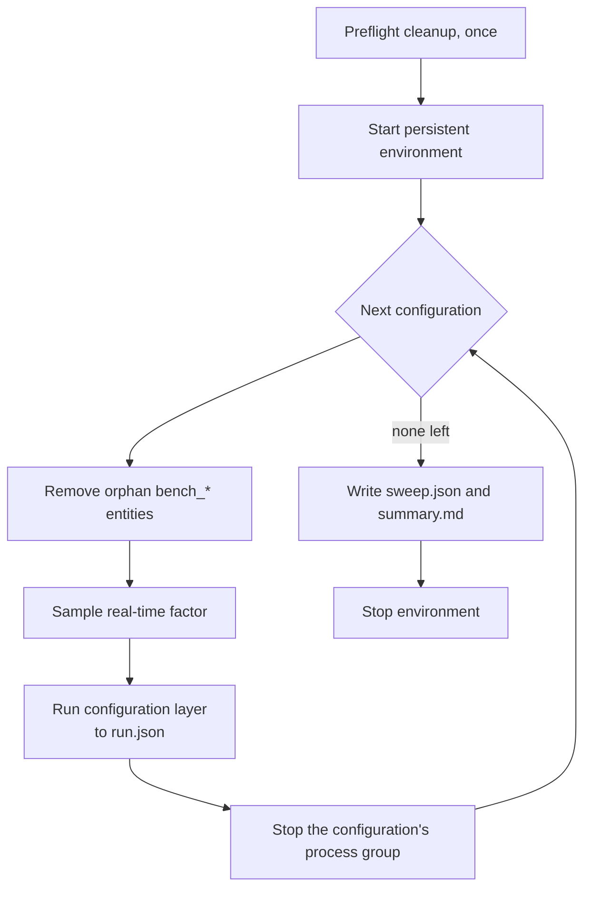

# Benchmark sweeps

`target_benchmark_sweep` compares several live configurations against one
persistent simulator environment. This page owns the sweep mechanism and file
format. The root [README](../../README.md) owns the commands,
[launch arguments](launch_arguments.md) lists every key a configuration may
set, and [outputs](outputs.md#sweep-outputs) owns what a sweep writes.

## Persistent environment

The supervisor starts the simulator selected by `backend`, RViz, the Ridgeback,
camera TF and the detector once. It then restarts only the measurement and
configuration layer for each entry. OWLv2 therefore loads once per sweep;
silhouette configurations still load their segmentation model inside their own
mask node.



*One environment serves every configuration; only the inner loop restarts.*

The supervisor runs `cleanup.sh` once, immediately before it starts the
environment. Do **not** run `cleanup.sh` between configurations: it kills the
simulator and RViz, which are deliberately persistent, although on Gazebo it
leaves `gz sim gui` running. The supervisor owns each configuration's process
group. Before each configuration it removes any orphan `bench_*` entities left
by an unclean exit, through the same scene-control services the runner uses,
and it shuts the environment down at the end.

Both layers run through `ridgeback_autonomy.benchmarking.interactive_launch`,
which is `ros2 launch` in its terminal mode. Stopping a layer therefore delivers
a single SIGINT to every process in it, exactly as Ctrl-C in a terminal does;
plain `ros2 launch` without a terminal would forward a second one to each
child.

Use `--skip-preflight-cleanup` only when another same-user ROS or Gazebo session
must stay alive. The sweep then skips the repository cleanup and warns that
stale processes are the operator's responsibility.

## Resume

Rerun the same command after an interruption. The latest incomplete sweep with
the same YAML and `--only` selection resumes, configurations with a valid
`run.json` are skipped, and partial configuration folders are preserved with an
`.incomplete_<timestamp>` suffix before the retry.
[Outputs](outputs.md#sweep-outputs) owns which recorded failures prevent reuse.
The resume identity includes the resolved detector settings, so a different
checkpoint starts a different sweep. `--report-only <sweep dir>` rebuilds the
cross-configuration report for a partial or completed sweep.

## Sweep file format

A sweep YAML holds a metadata block, sweep-wide defaults, and named configs:

```yaml
sweep:
  name: baseline
  description: Every estimator once at its defaults.

defaults:
  backend: gz        # persistent; gz or isaac, one simulator per sweep
  scenario: ''       # packaged benchmark_scenarios_full.yaml
  repeats: 1
  camera_profile: 640x480  # persistent; 1280x720 requires a new environment
  detector: owlv2
  detection_model: google/owlv2-base-patch16-ensemble
  target_labels: humanoid robot
  detection_threshold: 0.55
  detector_fps: 10.0

configs:
  - name: pointcloud
    estimators: pointcloud
  - name: mask_projective_ranging
    estimators: projective_ranging
    mask_gate: box
    depth_source: stereoscopic
    isolation_2d: nearest_mode_histogram
```

Config values override `defaults`. Validation happens before the simulator
starts and rejects unknown arguments, duplicate or unsafe names, bad estimators,
missing scenario files, environment keys on individual configs, and knobs that
do not apply to a config's estimators.

The environment cannot change mid-sweep, so these keys may be set only in
`defaults`:

- `backend`, `world`, `setup_path`, `namespace`, `use_sim_time`, `color_topic`
  and `camera_profile`;
- `detector`, `detection_model`, `target_labels`, `detection_threshold`,
  `detector_fps` and `detector_debug`;
- the backend-only settings: `gz_gui` and `headless_rendering` for Gazebo;
  `headless`, `rtf`, `sim_mode` and `depth_fidelity` for Isaac.

A setting of the other backend is refused, and `backend: hardware` is refused
outright. `benchmarking/sweep.py` and `localization_launch.py` hold the
authoritative key sets. The dry run prints the persistent environment command
and a trial and wall-time estimate. Before writing run evidence, the
configuration layer checks its recorded detector settings against the warm
detector.

## Shipped sweeps

The package installs these under `share/ridgeback_autonomy/config/`:

| File | Configs | Purpose |
|---|---:|---|
| `benchmark_sweep_baseline.yaml` | 4 | Every estimator once at its defaults: `pointcloud`, `mask_projective_ranging`, `mask_euclidean_reconstruction`, `mask_polar_profiling` |
| `benchmark_sweep_isolation.yaml` | 12 | Registered 2D and 3D isolation recipes, box-versus-silhouette controls, and paired depth-gate checks on the full benchmark |
| `benchmark_sweep_projective_parameters.yaml` | 15 | One projective-ranging constant at a time around its current value |
| `benchmark_sweep_model_concurrency.yaml` | 14 | Controlled sequential evidence for combined SlimSAM and Depth-Anything throughput |
| `benchmark_sweep_seat_validation.yaml` | 6 | Within-seat spread of two cells before any across-seat claim |

`benchmark_sweep_projective_parameters.yaml` varies `isolation_2d_band_m`,
`isolation_2d_min_bin_fraction`, `isolation_2d_bin_width_m` and
`min_valid_pixels`, and repeats the default configuration twice as an in-sweep
noise control. Its settled results are in the projective-parameter record under
[archived evidence](#archived-evidence).

`benchmark_sweep_model_concurrency.yaml` starts with a diagnostics-off/on A/A
pair, then runs three rotated replications of the box/silhouette by
stereoscopic/monocular matrix. Run it only from a clean, committed checkout; its
`sweep.json` records the exact sweep and scenario file hashes.
[BENCHMARKING — Combined-model throughput](../plans/BENCHMARKING_model_throughput.md)
owns its decision gates and interpretation, and the
[seat-validation plan](../plans/BENCHMARKING_environment_qualification.md) owns
the seat sweep.

## Archived evidence

- [projective parameter sensitivity](../../archive/engineering/projective_parameter_sensitivity.md)
