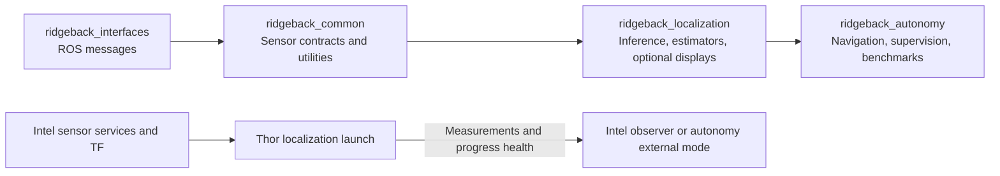
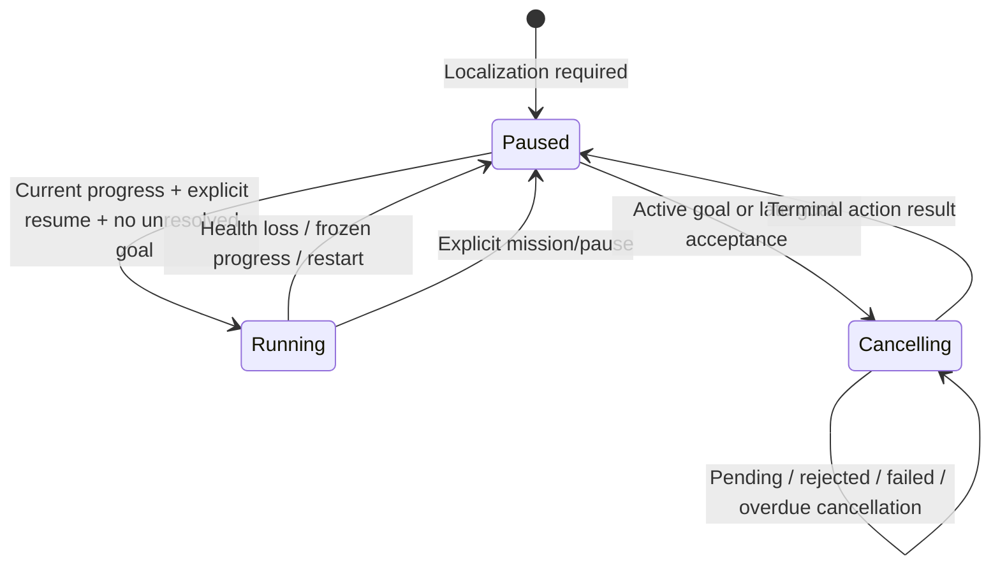

# Distributed localization contract

The same localization implementation runs on a workstation or Thor. Intel
can consume results without starting inference. Robot deployment remains a
stationary qualification task; the workstation checks below do not establish
Thor GPU compatibility, network performance, or safe physical motion.



Arrows between packages point from dependency to consumer. Common has no
navigation, benchmark, or inference-framework imports. Localization has no
Nav2, simulator, autonomy, or RViz dependency. Its display nodes publish ROS
images/markers and do not load model weights. Autonomy retains the benchmark,
configurator, replay, navigation, readiness, and general HUD entrypoints.

## Launch roles and configuration

The [README](../../README.md#distributed-localization) owns installation and
start/stop commands. `ridgeback_localization localization.launch.py` starts
compute and a separate health observer, with `displays:=false` by default.
`ridgeback_autonomy localization_observer.launch.py` starts only result displays
and a health consumer: no sensor bringup, Nav2, frontier goals, or inference.

Exploration retains its public launch. `localization_mode:=local` starts one
local detector and the selected estimator workers. `localization_mode:=external`
starts result consumers without a detector, measurement worker, or duplicate
health producer. In external mode and in the observer, the overlay's depth panel
subscribes to this host's aligned depth topic. The compute host's republish is
the frame it measured, but it would have to cross the link. The local stream
carries the same source stamps, because colour and aligned depth share them
exactly. The overlay keeps its last 60 colour and depth frames by stamp (about
2 s at 30 Hz) and draws each measurement on the pair it was measured from. It
falls back to the newest pair, with a warning, when the result is older than
that buffer. The
box gate's mask panel is derived
from the detections message. Only the silhouette gate's panel subscribes to the
compute host's `debug/target/mask`, the one image that then crosses the link.
`target_localization_enabled:=false`
suppresses the whole
localization block. External mode defaults `localization_required:=true`;
local mode retains optional localization unless explicitly required.

Supply the observed `base_frame`, namespace, and sensor topics. Standalone
compute and observer launches require `base_frame`; hardware exploration also
requires it when localization is enabled. Simulation exploration retains the
namespace-based simulator default. TF subscribers remap `/tf` and `/tf_static`
to relative names. Standalone/observer default to wall time; simulation uses
`use_sim_time:=true`. These settings must agree across hosts, with synchronized
host clocks for wall-time acquisition-age checks.

`RIDGEBACK_PERCEPTION_VENV` selects the compute Python environment. Without it,
a discovered checkout's `perception_venv` is used if present; otherwise the
current Python environment is used. Only compute process environments change.
An explicit invalid venv is rejected; Intel external/observer mode does not
inspect it. `RIDGEBACK_WORKSPACE` explicitly selects checkout resources;
otherwise checkout markers are discovered without assuming install depth.
Child runs inherit their launcher's environment, so restart an already-running
configurator after setting the variable. A direct
`ros2 run ridgeback_localization target_detector_node` bypasses this helper and
uses the Python environment of its own shell.

Compute processes load checkpoints only from the local Hugging Face cache: the
same helper sets `HF_HUB_OFFLINE=1` and `TRANSFORMERS_OFFLINE=1`, so a network
outage cannot stall startup on download retries. Set
`RIDGEBACK_MODEL_DOWNLOADS=1` in the launching shell for a first run that must
download weights; an explicit `HF_HUB_OFFLINE` from the caller wins. OWLv2 needs
the configured `detection_model`; `depth_source:=monocular` also needs the
Depth-Anything V2 metric checkpoint, and `mask_gate:=silhouette` the SlimSAM
checkpoint.

`detector:=owlv2` selects the only production detector. `detection_model`
identifies its checkpoint; the default remains
`google/owlv2-base-patch16-ensemble`. `target_labels` is a comma-separated list,
default `humanoid robot`. These are language queries, not a new trained G1 class.
`detection_threshold` defaults to `0.55`; `detector_fps` follows the
[cadence defaults](detection.md#detector-cadence-defaults). All five settings
are startup-only. Restart the compute process
to change them; Intel's observer and `localization_mode:=external` consume the
already-running detector and reject local detector overrides. Disabled target
localization starts no detector. Benchmark sweeps set detector settings in
`defaults`, since their detector is persistent; per-config changes are rejected.
Existing replay payloads retain their recorded detections and cannot change
detector queries after capture. Historical captures without detector identity
remain unknown rather than being assigned today's defaults.

## Intel RViz view

Hardware exploration in external mode lets Intel watch Thor's results over a
live map: Intel runs SLAM, Nav2 and RViz, and RViz shows the map, both LiDAR
scans, the target rings and the camera overlay. The README owns its build and
launch commands. Pass the same `estimators` and `mask_gate` that Thor runs. The
overlay's colour, depth and mask panels follow the external-mode rules above.
Without the patched `slam_toolbox` no map appears and Nav2 never starts.

With `backend:=hardware`, RViz opens a copy of the exploration layout without
the *2D Goal Pose* tool. Nav2's output reaches the robot's twist mux, so one
click would otherwise drive the robot even with frontier goals off. Any other
Nav2 client can still send goals, so keep the e-stop engaged until the command
chain is qualified.

Intel's VNC desktop renders RViz on the CPU, with no GPU. At the layout's
30 fps RViz took a full core, and the camera contract check failed with
467–567 ms depth gaps. With `backend:=hardware` the launch therefore:

- redraws at 10 fps;
- runs RViz at `nice -n 19`, pinned with `taskset` to the last two CPU cores on
  hosts with at least four;
- limits Mesa's software renderer to two threads (`LP_NUM_THREADS=2`).

RViz then uses about a quarter of a core, and the check passes with RViz open.
Viewing RViz from another computer avoids the load entirely.
`ridgeback_autonomy/rviz_layouts.py` derives the layout and the process limits.

## Topics, types, and acquisition semantics

All names below are relative to the selected namespace. Existing message fields,
source stamps, measurement coordinates, and debug topics are unchanged; their
shared types live in `ridgeback_interfaces`. See the
[pipeline reference](target_localization_pipeline.md) for estimator semantics and
[camera contract](camera_stack.md) for frames and aligned depth.

| Topic | Type | Producer / QoS |
|---|---|---|
| `detections/target/raw` | `ridgeback_interfaces/msg/TargetDetections` | Detector; reliable, depth 10 |
| `measurements/target/mask` | `ridgeback_interfaces/msg/TargetMeasurements` | Selected mask estimators; reliable, depth 10 |
| `measurements/target/pointcloud` | `ridgeback_interfaces/msg/TargetMeasurements` | Optional qualified pointcloud path; reliable, depth 10 |
| `debug/target/polar_beams` | `ridgeback_interfaces/msg/PolarBeams` | Optional debug publication; preserves scan and detection stamps |
| `localization/health` | `ridgeback_interfaces/msg/LocalizationHealth` | Separate health process; reliable, volatile, depth 10, every 0.5 wall seconds |
| `localization/workers/{detector,mask,pointcloud}` | `std_msgs/msg/String` JSON | Selected workers; reliable, transient-local, depth 1; state transitions |
| `localization/status` | `std_msgs/msg/String` JSON | Intel consumer; external mode, reported state/detail or missing health |
| `mission/status` | `std_msgs/msg/String` JSON | Transient-local frontier ownership state: required, paused, healthy, reason, pause_requested, handoff_safe, cancellation, cancellation_overdue, goal_pending, goal_active |
| `mission/pause` | `std_srvs/srv/Trigger` | Latch an external pause; success only when explorer Nav2 ownership is already fully released |
| `mission/resume` | `std_srvs/srv/Trigger` | Explicit settled and health-gated resume on the frontier owner; unavailable when frontier is not launched |

Sensor subscriptions generally use ROS sensor-data QoS; the detector's RGB
subscription uses best-effort keep-last depth 1, as described in
[detection scheduling](detection.md#frame-and-scheduling-behavior).
Health observes color and selected
sensor streams (CameraInfo, stereo depth, scan, or organized pointcloud), raw
detections, and every selected measurement output. Configure those topics to
match the actual producers; optional pointcloud requires explicit hardware
qualification. TF and source stamps remain sensor-owned.

Health fields include a monitor/worker `session_id`, compute `mode`, selected
`estimators`, `depth_source`, `mask_gate`, `labels`, `state`, and `detail`.
Parallel `streams`, `progress`, and `source_stamps` arrays identify each observed
stream and its advancing acquisition stamps. Progress increments only on a
strictly newer source stamp. Repeated old messages and heartbeat-only activity
do not refresh progress. Health timestamps use the selected ROS clock;
receipt/progress watchdogs use monotonic wall time, including when simulation
is paused. Restarting a producer changes the session; backward clock jumps
require restarting the pipeline and explicitly resuming a required mission.

| State | Meaning |
|---|---|
| `startup` | Required streams have not all produced data within the startup window |
| `processing` | All required streams have current, advancing acquisition stamps |
| `stale_input` | A required sensor is missing, frozen, too old, or future-dated |
| `stalled` | Sensor inputs remain current but detections or selected measurement output do not progress |
| `failure` | A worker explicitly reported a caught processing/model failure |

A current batch with no target is healthy. Health reports processing/liveness,
not localization accuracy: calibration, TF correctness, usable estimates,
and physical sensor qualification still need their own evidence. Worker publishers that disappear (or never appear before the startup deadline)
are reported as failure; duplicate worker publishers are also rejected. Missing
output progress still detects a live but stalled worker.

| Setting | Default | Meaning |
|---|---:|---|
| `startup_timeout` | 120 s | Maximum initial wait for all streams |
| `input_timeout` | 3 s | Maximum wall interval without sensor stamp progress |
| `progress_timeout` | 15 s | Maximum wall interval without each output's progress |
| `source_age` | 15 s | Maximum source age against the selected ROS clock |
| `health_timeout` | 3 s | Intel/frontier maximum interval without health messages |
| `localization_progress_timeout` | 15 s | Frontier watchdog against frozen progress despite health messages; exploration forwards `progress_timeout` |
| `cancellation_timeout` | 5 s | Mark unresolved cancellation overdue; never treat timeout as success |

Compute timeout values must be finite and positive. Set matching progress
budgets on both hosts for the measured inference cadence. The Intel stationary
status viewer reports remote state and missing heartbeat; the mission owner
also independently verifies every progress counter and source stamp advances.

## Mission pause and cancellation



A required mission starts inhibited and needs `mission/resume` after at least
two advancing health observations. Exploration requires it with
`localization_mode:=external`, or explicitly with `localization_required:=true`.
In simulation or fake-server qualification, after healthy advancing input and
a resolved previous goal, resume explicitly:

```bash
ros2 service call /r100_0001/mission/resume std_srvs/srv/Trigger '{}'
```

Loss latches a pause and requests cancellation
of the frontier owner's active `NavigateToPose` goal. A goal accepted after
health loss is immediately canceled. Recovery alone never resumes the mission.

A cancellation acknowledgment is not a terminal result. While acceptance or
cancellation is pending, rejected, failed, or overdue, resume is refused and new
goals are inhibited. Only a confirmed terminal action result releases the old
goal; an exception retrieving that result leaves the pause intact. Status
reports the cancellation outcome. This supervises this application's frontier
goals, not arbitrary Nav2 clients, teleoperation, or a physical emergency stop.
Hardware autonomous motion remains off by default; do not enable it for the
stationary milestone.

An external mission uses `mission/pause` before taking Nav2 ownership. The
request latches even when its Trigger response has `success=false`; that value
means explorer ownership is still unresolved. Ownership transfers only
when transient-local `mission/status` reports both `pause_requested=true` and
`handoff_safe=true`. The explorer keeps an active handle throughout cancellation
and clears it only for a matching terminal action result. Rejected, failed, or
overdue cancellation never produces a safe handoff. Repeated pause calls are
idempotent. Resume is explicit, preserves localization-health checks, and is
refused while any explorer acceptance, goal, or cancellation remains unresolved.

## Workstation inference environment

The workstation uses `perception_venv/` in the checkout, built from
`requirements-perception.txt`; the README owns its setup commands. That file
pins the CUDA 12.8 (`cu128`) PyTorch build, which carries the `sm_120` kernels
that Blackwell GPUs such as the RTX PRO 6000 need. Plain `torch` from PyPI is a
CPU-only build and silently runs OWLv2 and Depth-Anything on the CPU. For
another GPU or CUDA version, change the index URL and torch pins in that file.

## Thor inference environment

Thor (JetPack 7, CUDA 13.0, `sm_110`) uses a `venv` over the system Python 3.12
with `--system-site-packages`, as on the workstation, so compute nodes import
ROS Jazzy's `rclpy`, `cv_bridge` and NumPy directly. Conda was rejected because
its Python cannot reliably load the system ROS build; Thor's existing
`~/miniforge3` environment belongs to another project. The venv lives at
`~/venvs/dynamo-perception`, outside every checkout, and launches select it with
`RIDGEBACK_PERCEPTION_VENV`. `requirements-perception-thor.txt` holds the setup
commands and pins the workstation's `torch 2.11.0`/`torchvision 0.26.0` in
their PyTorch CUDA 13.0 builds; NVIDIA's Jetson AI Lab index is the fallback
only if `tools/intel_thor/check_perception_env` fails, and its different
versions would need a new decision. Creating the venv needs Ubuntu's
`python3.12-venv`. On the 2026-10-09 install, `pip check` reported two
accepted items outside the model stack: Ubuntu's `python3-nacl` without
`python3-cffi`, and a platform-tag warning for `nvidia-cusparselt-cu13`, which
PyTorch loads.

## Qualification and paired rollback

Both hosts run the same installed revision since 2026-10-16 (P1 in the
[qualification plan](../plans/PHYSICAL_remaining_qualification.md)); the
workstation runtime evidence is under [Archived evidence](#archived-evidence).
The workstation handoff candidate was `eaacd24b`, with build, import, replay and
installed-smoke evidence under `artifacts/package-split/integration-eaacd24b/`.
Recorded-input parity establishes schema and scoring preservation, not runtime
timing equivalence; rerun live performance before quoting results for this
process layout or non-default label queries.

On `r100_0160` (2026-10-16, P1 and P2) both hosts ran `dev` `a31e770` and
`check_link --no-traffic` passed 30 checks with matching revisions and a
−0.02 ms clock offset. Killing the detector reported health `failure` and
returned to `processing` 8 s after relaunch; since 2026-10-21 workers respawn
automatically (`processing` within 13 s, no service restart), and Thor runs
`dynamo-localization.service` from boot. A Thor cable pull recovered PTP in
about 5 s after the PHC step fix. All four localization modes started and
reached `processing` on the Thor GPU, with box-stereo delays of 367/383 ms,
box-mono 575/592 ms, Thor at no more than 68 °C, a person tracked at two marks,
and no false detections in a 28 s empty segment. Distance accuracy at taped
marks, silhouette timing and G1 target cases were not measured; see the
[deferred gates](../BACKLOG.md#deferred-hardware-gates).
The current workstation checks include clean headless builds/imports, generated
serialization, unchanged recorded-input estimator/scoring results, launch-role
construction, fake Nav2 action cancellation, and bounded headless Gazebo/Isaac
runtime checks with localization on/off at both supported camera resolutions.
These startup and empty-frame progress checks do not qualify target-distance
accuracy, sustained performance, GUI behavior, or physical deployment. The robot
team must acknowledge the exact commit actually installed on each host; branch
names are insufficient.

Before deployment record `git rev-parse HEAD`, dependency-manifest hashes,
`tools/check_dependencies` output, effective launch arguments, environment/model
versions, topics/types/frames, and per-host logs. Keep a separate build/install
prefix for each candidate so rollback cannot accidentally load stale generated
messages or copied executables.

To roll back, stop only the processes started by this deployment on both hosts,
restore the same previously accepted revision and its matching dependency pins
on both, rebuild in fresh prefixes, and source only the restored prefixes in
new shells. Restore host configuration separately from code. Restart the
stationary consumers/compute and recheck message types and health. Never pair
new `ridgeback_interfaces` publishers with old `ridgeback_autonomy/msg/*`
consumers. Preserve old bags unchanged; use their original environment or an
explicit conversion. Do not run simulator cleanup on the robot.

## Archived evidence

- [Simulator runtime matrix and receive-buffer correction](../../archive/engineering/2026-09-18-package-split-runtime.md)
- [Intel RViz view of Thor localization on r100_0160](../../archive/engineering/2026-10-13-r100-0160-intel-rviz-observer.md)
